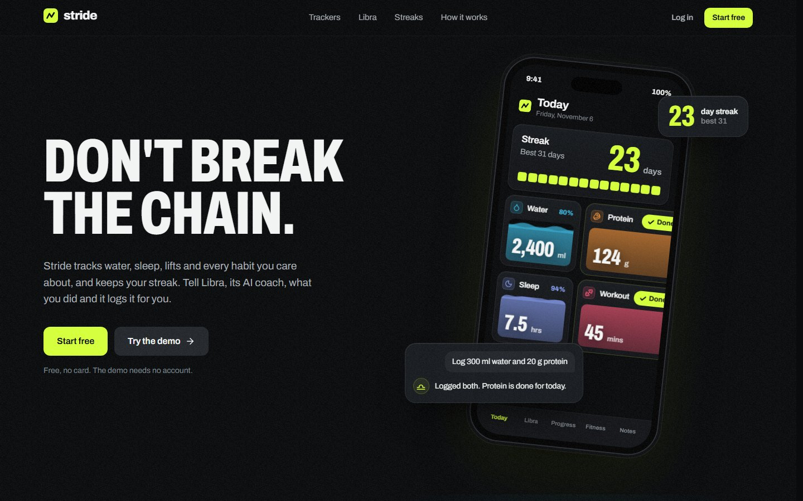
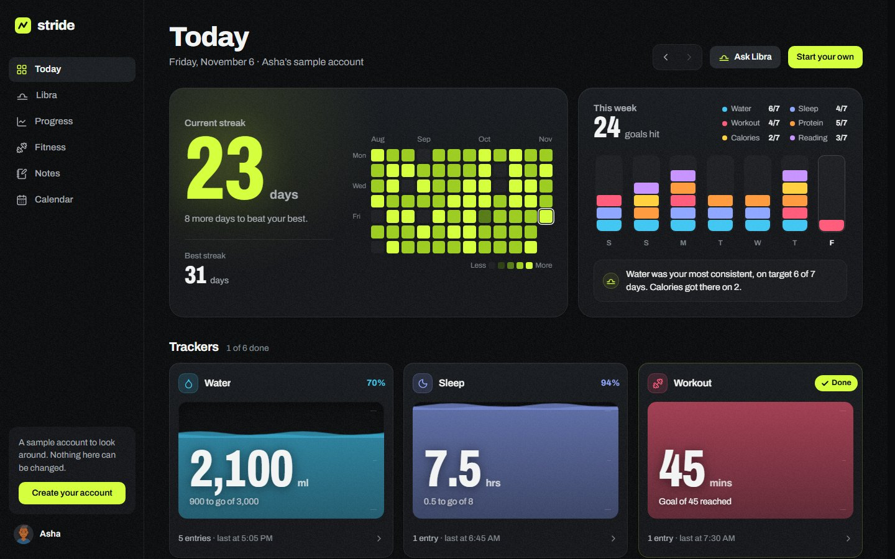
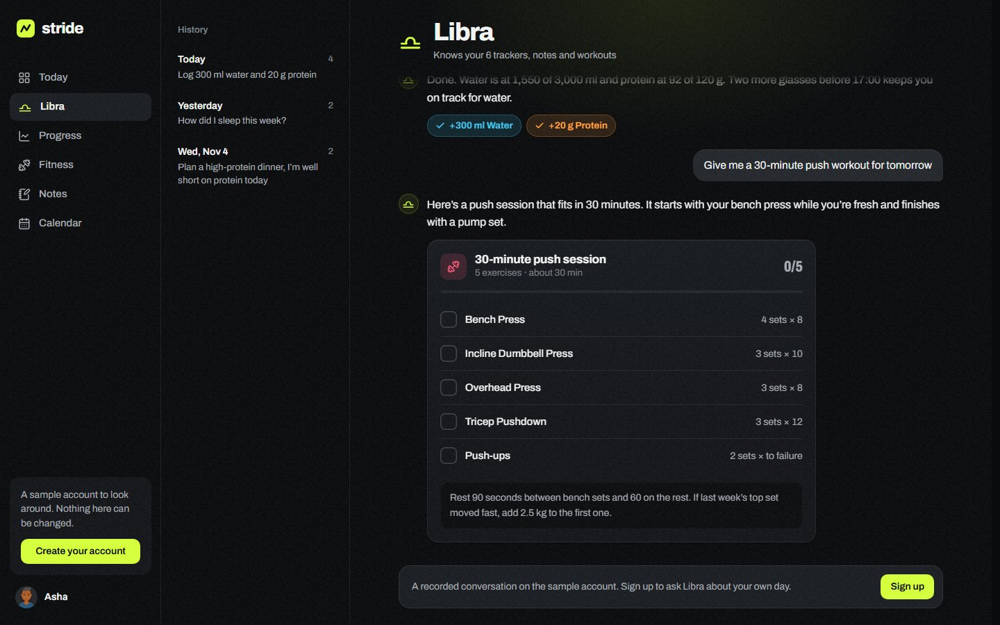
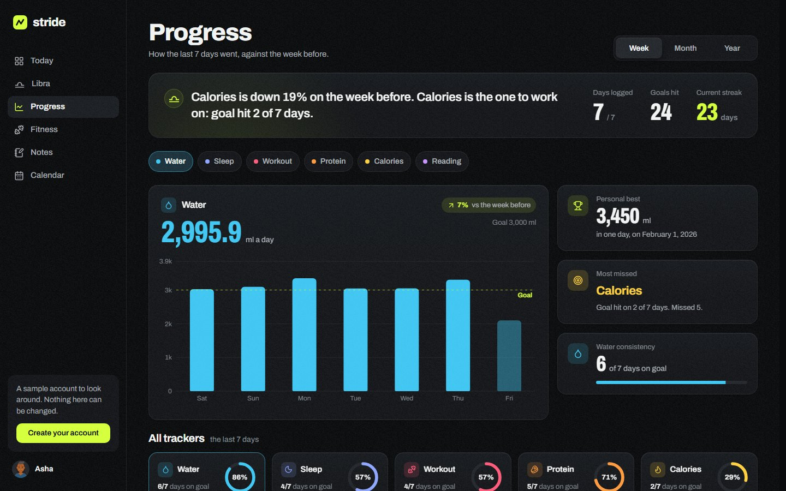
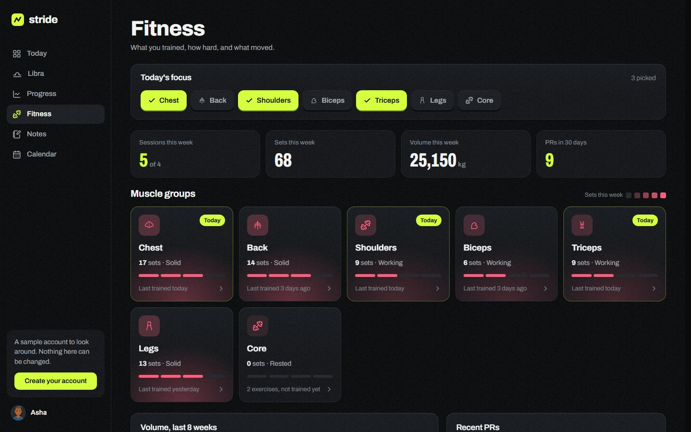
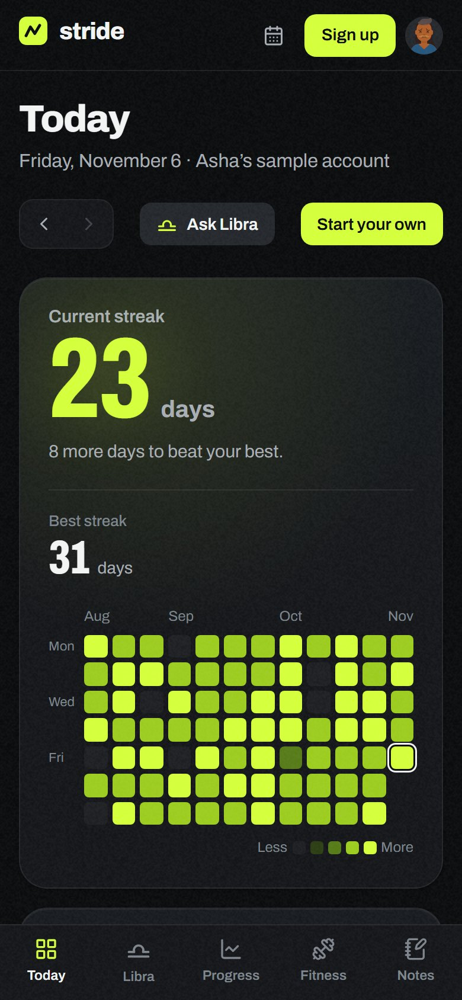

# Stride

A habit and fitness tracker with an AI copilot that can act on your data, not just talk about it.

**Live:** https://stride-ks.vercel.app · **Demo, no account needed:** https://stride-ks.vercel.app/demo

## Features

- **Custom trackers.** Track anything with a unit and a daily target: water, sleep, protein, study hours. Each tracker has its own colour (pick one or let the name choose), a wave that fills toward the target, quick-add buttons sized to its unit that update the total instantly, and a sheet with the day's entries. On phones, hold a card or swipe it left to edit or delete it.
- **Streak and week.** Any logged day counts. The dashboard leads with the current and best streak and a 12-week heatmap, next to a weekly chart of goals hit per tracker with a one-line Libra summary of the week. Any past day can be opened from the calendar, and entries logged there land on that day.
- **Calendar.** A month view with a dot per tracker in its colour (filled when the goal was hit), marks for training days and notes, and lime for days where every goal was hit. Tap a day for its logs, sets and notes in a side panel (a bottom sheet on phones). Swipe or use the arrow keys and Page Up/Down to move between days and months; tracker chips filter the dots.
- **Fitness by muscle group.** Pick the day's focus groups and see each group's training load this week, weekly volume over 8 weeks, recent PRs and sessions. Each exercise has sets/reps/weight steppers, PR detection, a rest timer that starts after every log, best lifts (heaviest, estimated 1RM, best session), volume per session and a history table.
- **Progress.** Switch between week, month and year: a one-line read of the period, days logged and goals hit, a chart per tracker against its goal, the change on the previous period, personal best and most-missed goal, goal-hit rings for every tracker, and a 12-month heatmap for one tracker or all of them.
- **Notes.** A searchable list beside the editor (full-screen editor on phones). Notes save as you type, with a saving/saved indicator; Libra reads the five most recent.
- **Libra, the copilot.** A chat assistant backed by Gemini with function calling. It reads your trackers, logs, notes and workouts as context, and can log entries, create new trackers, and generate meal or workout plans. Replies stream in as they are written; what Libra did shows as chips in each tracker's colour; workout plans are checklists (and can log their minutes when finished) and each meal in a plan can be added to today's protein and calories. History is grouped by day.
- Onboarding flow, product tour and profile with avatars.
- **Profile.** Pick a DiceBear avatar (or shuffle for new ones), name, gender (Male, Female, Non-binary, Prefer not to say, or your own words), metric or imperial units (used for height, weight and lifting weights everywhere), age/height/weight with a live BMI scale, and every tracker's daily goal plus a weekly training-sessions goal in one place. Changes collect in a save bar with Discard.
- **Read-only demo** at `/demo`, linked from the landing page: every page (Today, trackers, Libra with a recorded conversation, Progress, Fitness, Notes, Calendar, Profile) runs on a sample account with a year of history. Under `/demo` the Supabase client is swapped for an in-memory copy (`src/lib/demoDb.js`), so nothing is sent anywhere, writes are refused and Libra makes no Gemini calls.
- Desktop layout with a sidebar, phone layout with a bottom tab bar.

## Tech stack

- Next.js 16 (App Router), React 19
- Supabase (Postgres, Auth)
- Google Gemini API (`@google/genai`)
- CSS Modules and a small set of global tokens (`src/app/globals.css`), Archivo via `next/font` (variable weight and width)
- Framer Motion, Recharts, lucide-react
- Deployed on Vercel

## How the copilot works

The client sends the message along with the user's Supabase access token. The API route verifies the token, builds a context summary of that user's data, and calls Gemini with a set of tool definitions (`src/lib/tools.js`). If the model calls a tool, the route runs it against Supabase (`src/lib/tool-executor.js`) and sends the result back to the model for the final reply.

## Screenshots

Taken from the read-only demo at [stride-ks.vercel.app/demo](https://stride-ks.vercel.app/demo).



| Today | Libra |
| --- | --- |
|  |  |
| **Progress** | **Fitness** |
|  |  |

<p align="center"></p>

## Running locally

Requires Node 20+ and a Supabase project.

```bash
git clone https://github.com/phanindraks2005/stride.git
cd stride
npm install
cp .env.example .env.local   # fill in your keys
npm run dev
```

The app runs at http://localhost:3000.

### Environment variables

| Variable | Description |
| --- | --- |
| `NEXT_PUBLIC_SUPABASE_URL` | Supabase project URL |
| `NEXT_PUBLIC_SUPABASE_ANON_KEY` | Supabase anon key, used by the browser client |
| `SUPABASE_SERVICE_ROLE_KEY` | Service role key, used only in the API route. Never expose it to the client |
| `GEMINI_API_KEY` | Google AI Studio API key |

### Database

The app expects these tables, each with a `user_id` column tied to `auth.users`: `profiles`, `trackers`, `logs`, `notes`, `muscle_groups`, `exercises`, `exercise_logs`, `daily_selections`, `messages`.

Run [`supabase/schema.sql`](supabase/schema.sql) in the Supabase SQL editor to create them with row-level security (it is safe to run again; later additions such as `trackers.color`, `profiles.units` and `profiles.weekly_sessions` are `add column if not exists`). Turn off email confirmation, since sign-up seeds the starter trackers straight away. Without the newer profile columns the app still works and keeps units and the weekly goal in the browser.
